 

 

## 忍 &nbsp;SHINOBI PROSTHETIC&nbsp; 忍

| 🗡️ ARMA | 🪝 GANCHO | 🔥 FOGO | 🛡️ ESCUDO | 🏮 SANTUÁRIO |
|:---:|:---:|:---:|:---:|:---:|
|  |  |  |  |  |
| Coroutines | Retrofit | Material 3 | MockK | SQLite |

## ⛩️ &nbsp;ÁRVORE DE HABILIDADES&nbsp; ⛩️

<table width="100%">
<tr>
<td width="33%" valign="top" align="center">

### 🟣 ARTES ASHINA

</td>
<td width="33%" valign="top" align="center">

### 🔴 ARTES SHINOBI

</td>
<td width="33%" valign="top" align="center">

### ⚫ ARTES DA PRÓTESE

</td>
</tr>
</table>

## ⚔️ &nbsp;CAMPO DE BATALHA&nbsp; ⚔️

 

 

  

## 🏆 &nbsp;CONQUISTAS&nbsp; 🏆

 

## 🏮 &nbsp;SANTUÁRIO&nbsp; 🏮

&nbsp;&nbsp;&nbsp;&nbsp;

&nbsp;&nbsp;&nbsp;&nbsp;

